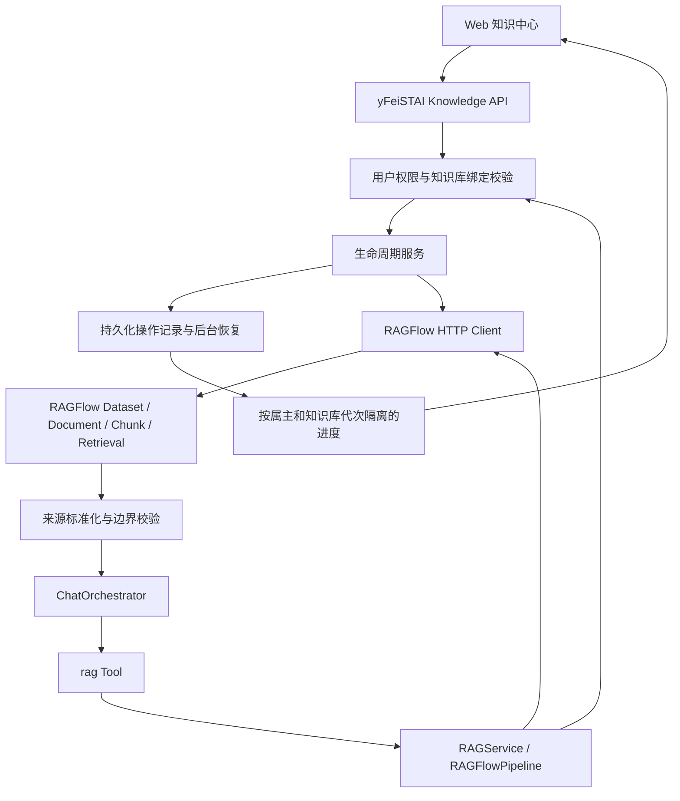

# yFeiSTAI × RAGFlow：知识库与知识全生命周期 API 对接方案

日期：2026-09-06。状态：已确认架构的完整设计与实施清单，业务代码待实现。

本方案合并已确认的 Managed RAGFlow Provider、数据模型、接口映射与组件设计，并补齐测试、迁移、灰度、回滚和实施顺序。用户已要求不再逐段确认，后续按本方案完成范围内的常规实施决策。

源码基线：RAGFlow `v0.27.1`，提交 `b9df87c4c75a5b0d35c90d15329fc0f6f91cb73e`。yFeiSTAI 调研基线：`2b2664cf9ab19c9209cb8d5ca538a96d0616ef57`。运行中实例的版本和能力仍须独立核验，下载源码不代表已部署该版本。

## 1. 推荐方案与交付边界

采用独立部署 RAGFlow、由 yFeiSTAI 服务端深度调用其公开 HTTP API 的方案。用户在 yFeiSTAI 内完成知识库、文档和 Chunk 管理，以及带来源引用的学习问答。

| 责任 | yFeiSTAI | RAGFlow |
| --- | --- | --- |
| 业务身份 | 用户、租户、知识库授权、代次与绑定 | 服务账户/API Key 所属的远端访问范围 |
| 知识管理 | 逻辑知识库、接入流程、操作流水、启用/停用策略、审计 | Dataset、Document、Chunk、原文件及索引 |
| 文档处理 | 调度、权限校验、进度展示、错误恢复 | 解析、OCR、分块、向量化、索引和检索 |
| 智能交互 | ChatOrchestrator、Tools、Capabilities、会话、模型调用、引用 | 返回检索片段及来源位置 |

第一版涵盖：连接配置、创建/附加知识库、上传/网页导入、文档列表与下载、解析/取消/重试、元数据与解析配置修改、Chunk 增删改查和启停、检索参数、知识停用/恢复、解除绑定、明确指定的远端删除、操作审计及重启恢复。

本次知识生命周期是“接入 → 解析 → 质检 → 启用 → 检索利用 → 更新/重建 → 停用/归档 → 删除/恢复”。其中版本标识、停用策略和业务审计由 yFeiSTAI 管理；不能把远端解析成功直接等同于知识质量合格，也不能把 RAGFlow 原生接口描述为完整审批、不可变版本或回收站系统。

审批流、复杂文档 ACL、连接器市场、定时全源同步、RAGFlow Chat/Agent 编排和知识图谱运维不是本版验收项。已有 ingestion pipeline 的执行与取消纳入适配；可视化编辑远端 pipeline 不纳入本版。

## 2. 与当前仓库的衔接



已核验的接入点：

| 现有文件 | 集成改动 |
| --- | --- |
| `deeptutor/services/rag/factory.py` | 注册 `ragflow` Provider，沿用按知识库选择引擎 |
| `deeptutor/services/rag/provider_binding.py` | 继续以 `kb_config.json` 为绑定权威来源 |
| `deeptutor/services/rag/service.py` | 复用检索入口、grounded retrieval 与生命周期入口 |
| `deeptutor/services/rag/pipelines/base.py` | 遵守 `initialize/add_documents/search/delete` 协议 |
| `deeptutor/knowledge/kb_types.py` | 区分远端管理、文档上传、本地原文件和 Chunk 管理能力 |
| `deeptutor/knowledge/manager.py` | 注册 managed/attached 绑定、返回脱敏描述、代次更新 |
| `deeptutor/multi_user/knowledge_access.py` | 复用权限和 generation 校验，补充远端绑定身份复核 |
| `deeptutor/multi_user/paths.py` | 复用显式属主路径和 `owner_secrets_dir` |
| `deeptutor/api/main.py` | 在现有鉴权依赖下注册 RAGFlow 管理子路由与启动恢复任务 |
| `deeptutor/api/routers/knowledge.py` | 保留 `/create`、`/{kb_name}/upload` 等现有客户端契约 |
| `deeptutor/api/utils/task_id_manager.py` | 将兼容任务 ID 关联到持久化 operation_id |
| `deeptutor/api/utils/progress_broadcaster.py` | 复用投递机制，RAGFlow 通道使用完整资源身份 |
| `deeptutor/services/rag/retrieval_view.py` | 复用内容上限、来源白名单和视图摘要 |
| `web/components/knowledge/CreateKbModal.tsx` | 增加 RAGFlow 创建/附加流程 |
| `web/lib/knowledge-api.ts` | 增加类型化管理 API 和异步操作响应 |

需要纠正的实现前提：

1. 现有 `TaskIDManager`、`ProgressBroadcaster` 主要依赖进程内状态；`ProgressTracker` 的 `.progress.json` 是快照，不是持久任务队列。
2. 普通 rag Tool 与 `search_grounded()` 的数据出口不同；前者可能将完整结果放入工具 metadata。必须分别检查和清洗，不能假设所有调用都自动经过 `bounded_retrieval_view()`。
3. 当前授权描述复核 Provider 字符串和代次，不能单独识别同代次的 Dataset 或连接目标变更。RAGFlow 要增加完整 binding fingerprint。
4. 当前知识进度通道有按 `kb_name` 标识的路径。RAGFlow 不能仅用名称隔离租户，订阅时和投递时都要验证授权。
5. 当前真实创建路由是 `/api/v1/knowledge/create`。前面讨论中的无后缀 `POST /knowledge` 是资源示意，实施使用现有契约。

## 3. 数据模型及权威来源

### 3.1 Connection profile

非秘密配置放入现有用户/管理员 runtime settings；秘密放在属主私密目录，由 `secret_ref` 引用。以下为目标结构示例，不是已经存在的配置：

```json
{
  "schema_version": 1,
  "profile_id": "ragflow-default",
  "credential_owner_id": "account-001",
  "base_url": "https://ragflow.example.internal",
  "secret_ref": "ragflow/default/api-key",
  "credential_revision": 1,
  "api_contract": "ragflow-v0.27.1",
  "verify_tls": true,
  "connect_timeout_seconds": 5,
  "read_timeout_seconds": 60,
  "upload_timeout_seconds": 300
}
```

地址由有连接管理权限的人配置；请求只能选择 profile。`base_url` 仅对有配置读取权限的管理者显示，不能放入普通 KB 列表、日志、引用或模型上下文。检测不到运行版本时返回 `version_unknown`，健康检查成功不等于版本已验证。

密钥轮换增大 `credential_revision` 并清除旧客户端缓存；绑定不可静默切换地址/远端资源。需要切换时按维护流程产生新 `binding_version`，使已有授权描述和在途结果失效。

### 3.2 KB binding

```json
{
  "type": "ragflow",
  "rag_provider": "ragflow",
  "generation_id": "平台生成的稳定知识库代次",
  "ragflow": {
    "schema_version": 1,
    "profile_id": "ragflow-default",
    "credential_owner_id": "account-001",
    "dataset_id": "远端数据集 ID",
    "ownership": "managed",
    "access_mode": "manage_documents",
    "binding_version": 1,
    "lifecycle_state": "active",
    "remote_delete_policy": "explicit_only",
    "retrieval": {
      "page_size": 8,
      "similarity_threshold": 0.2,
      "vector_similarity_weight": 0.3,
      "keyword": false
    }
  }
}
```

`ownership=managed` 表示本平台创建并管理该 Dataset；`attached` 表示附加现有库。`ownership` 不代替写权限：attached 默认 `read_only`，显式启用 `manage_documents` 后才可以上传、解析和编辑，仍不能通过本集成删除整个远端 Dataset。

服务端计算 `binding_fingerprint`，输入至少包含资源属主、generation、规范化连接地址、profile_id、dataset_id、binding_version、credential_owner_id 和 credential_revision。浏览器不能自行提供可信摘要。

RAGFlow 保存内容和索引；平台保存绑定、操作证据、文档版本关系和可见性策略，不保存第二份可查询 Chunk 索引。文档列表来自远端，缓存只用于展示，权限与删除决策必须使用当前授权和远端身份。

### 3.3 持久化操作与文档管理状态

第一版推荐独立的知识操作 SQLite 存储，位于服务端系统目录 `data/system/ragflow/operations.sqlite3`，不进入用户可执行沙箱。它不依赖 OpenMAIC 教学模块的数据库启动。使用事务、唯一约束、租约和单调递增版本；所有查询强制 owner/workspace/generation 条件。

目标表：

| 表 | 必要字段/约束 |
| --- | --- |
| `ragflow_operations` | operation_id、actor_id、resource_owner_id、workspace_scope、generation_id、binding_fingerprint、action、idempotency_key、request_digest、state、revision、lease_owner、lease_until、next_attempt_at、created_at、updated_at |
| `ragflow_operation_items` | operation_id、item_id、远端 ID、临时上传名、source_sha256、预期变更摘要、远端回执、单项状态、脱敏错误码 |
| `ragflow_document_state` | owner/generation/binding/document 联合身份、logical_document_id、content_revision、desired_visibility、observed_visibility、source_sha256、replacement_of；不镜像正文 |
| `ragflow_operation_events` | 单调 event_id、operation_id、事件类型、脱敏状态、时间；用于审计和断线追赶 |

相同 `(resource_owner_id, workspace_scope, generation_id, action, idempotency_key)` 必须唯一。同键同 payload 返回同一 operation_id；同键异 payload 返回 `409 idempotency_conflict`。

SQLite 仅用于单主机本地持久盘部署，可用数据库租约协调同机进程，不放在 NFS/多主机共享盘。多主机 HA 是另一个明确部署门槛：迁移为共享事务数据库并验证租约与事件投递之后才能上线该拓扑，不能声称文件快照已支持 HA。

租约只决定谁负责对账，不证明远端写入不会重复。发生接管时，已开始发送的操作一律先查询远端状态；原执行者持有过期租约不得继续推进后续写步骤。平台无法单凭租约实现 RAGFlow 侧 exactly-once。

### 3.4 上传暂存

流式读取请求并计算 SHA-256，写入 owner 隔离、容量受限、沙箱不可见的暂存目录。完整暂存并持久化意图后才能返回后台上传的 `202`。它是短期恢复材料，不是知识内容镜像。

暂存文件有引用记录和保留期限；在操作对账结束前不能清理。清理遵循项目安全删除要求，使用可恢复隔离/回收机制，不能永久删除未核验的路径。下载/迁移原件不覆盖用户已有文件。

## 4. API 映射

下表路径属于上游 v0.27.1，均由后端附带 `Authorization: Bearer`，健康接口按上游实际认证要求处理。字段以本地固定版本文档和接口测试为准。

| 生命周期动作 | RAGFlow API |
| --- | --- |
| 健康 | `GET /api/v1/system/healthz` |
| 创建/列表 Dataset | `POST /api/v1/datasets`；`GET /api/v1/datasets` |
| 更新/删除 Dataset | `PUT /api/v1/datasets/{dataset_id}`；`DELETE /api/v1/datasets`，显式 `ids` |
| 上传本地/网页/空文档 | `POST /api/v1/datasets/{dataset_id}/documents`，按 `type` 分流 |
| 文档列表 | `GET /api/v1/datasets/{dataset_id}/documents` |
| 更新/下载文档 | `PATCH` / `GET /api/v1/datasets/{dataset_id}/documents/{document_id}` |
| 删除文档 | `DELETE /api/v1/datasets/{dataset_id}/documents`，显式 `ids` |
| 内置解析启动/取消 | `POST` / `DELETE /api/v1/datasets/{dataset_id}/chunks`，显式 `document_ids` |
| 已配置 ingestion pipeline 执行/取消 | `POST /api/v1/documents/ingest`，`doc_ids`、`run`，按动作处理 `delete` |
| Chunk 列表/新增 | `GET` / `POST /api/v1/datasets/{dataset_id}/documents/{document_id}/chunks` |
| 单 Chunk 读取/编辑 | `GET` / `PATCH /api/v1/datasets/{dataset_id}/documents/{document_id}/chunks/{chunk_id}` |
| Chunk 删除/批量启停 | `DELETE` / `PATCH /api/v1/datasets/{dataset_id}/documents/{document_id}/chunks` |
| 检索 | `POST /api/v1/retrieval` |

不能把“删除一个 Chunk”错误实现为未经验证的单对象 DELETE URL；按公开集合删除接口发送明确列表。任何批量删除都禁止空 ID 集合、省略目标或 `delete_all=true`。

上游上传的本地文件使用 multipart；网页使用对应 multipart 的 name/url；空文档按 API 要求使用 JSON。metadata 通常需在取得 document_id 后 PATCH，不能假设上传与 metadata 原子写入。

yFeiSTAI 路由在现有 `/api/v1/knowledge` 下扩展：

| 平台路由（相对此前缀） | 契约 |
| --- | --- |
| `GET/PUT /rag-pipelines/ragflow/profiles/{profile_id}` | 连接配置与脱敏状态 |
| `POST /ragflow/probe`；`GET /ragflow/datasets` | 只读健康、认证、兼容探测与可附加列表 |
| `POST /create` | 保留现有创建入口；ragflow 分支创建 managed Dataset |
| `POST /connect-ragflow` | 建立 attached 绑定 |
| `POST /{kb_ref}/upload` | 保留现有入口；RAGFlow 分支接受文件，返回 operation_id 与兼容 task_id |
| `POST /{kb_ref}/documents` | 网页/空文档；统一生命周期服务 |
| `GET /{kb_ref}/documents` | 分页列表，包含安全化解析状态与平台可见性 |
| `GET/PATCH/DELETE /{kb_ref}/documents/{document_ref}` | 详情/配置/单项删除，通过平台服务映射远端 API |
| `GET /{kb_ref}/documents/{document_ref}/download` | 经过权限校验的原文件流，不暴露远端存储 URL |
| `POST .../{document_ref}/parse`；`POST .../{document_ref}/cancel` | 启动、重新解析、取消 |
| `GET/POST .../{document_ref}/chunks`；`PATCH/DELETE .../chunks/{chunk_ref}` | Chunk 管理，平台可提供单对象操作并映射为远端显式 ID 集合 |
| `POST /{kb_ref}/retrieval-test` | 授权管理者的检索质量测试，同样经过查询权限与来源清洗 |
| `GET /{kb_ref}/operations/{operation_id}` | 持久化状态、单项结果、revision 和事件游标 |

`kb_ref` 支持项目现有资源引用，不能仅靠可重名的显示名称定位。document_ref/chunk_ref 是平台生成的 opaque 引用；服务端映射记录包含 binding/generation，不能把不可猜测 ID 本身当成权限校验。

所有耗时写操作都先持久化再返回 `202 {operation_id, task_id, state, accepted, revision}`。202 只代表任务已受理。列表、配置查询、下载等同步响应不强行包装为异步任务。

## 5. 状态机、幂等与故障恢复

操作状态与远端文档状态分开：

```text
INTENT_RECORDED → SEND_STARTED → ACKNOWLEDGED → RECONCILING → RECONCILED
                        └────→ RESULT_UNKNOWN ────────────────┘
确认任何副作用之前已拒绝 → FAILED
冲突/多个候选/无法证明结果 → NEEDS_ATTENTION
```

`RECONCILED` 表示本次动作的预期效果已核对。例如上传成功仅表示远端文档存在；解析动作必须等到终态且通过可用性检查。取消请求已收到与远端确认取消是不同状态，远端在取消竞态中完成时显示真实结果。

文档观察状态为 `uploading/unstart/parsing/ready/failed/cancelled/unknown`；平台可见性为 `draft/active/disabled/archived`，删除再增加 `delete_pending/deleted`。未知枚举进入 unknown，不能视为 ready。没有可检索 Chunk 的 DONE 文档显示空内容/需检查，不能假装检索已可用。

幂等与补偿：

1. Dataset 创建使用含 operation 标记的唯一临时名称及说明标记；响应丢失后在授权账户范围分页查找、逐个核对。只有唯一且证据一致的候选才能绑定。一次查询零候选不证明远端没有提交，须考虑延迟可见性并继续有界对账；不能据此自动重发创建。
2. 上传前固定文件哈希，远端上传名采用 `operation_id + item_id + 安全文件名` 并保留真实扩展名。收到远端 ID 后写入平台记录，再 PATCH 保留字段并恢复显示名。对账先查临时名，也查已确认 ID 和本地阶段；不能仅依赖可能尚未写入的 metadata。
3. 保留 metadata 包括 generation、operation_id、source_sha256、source_kind。远端可修改这些字段，它们只是关联证据，不授予权限；属主优先使用不含个人信息的 scope token。
4. 幂等键用于同一逻辑操作。文件哈希仅在同一 owner/KB 内辅助发现重复，默认提示并关联已有文档；显式要求新增独立资料或替换版本时尊重该动作，不能用全局哈希吞掉新业务操作。attached 库没有可靠哈希时不凭文件名判定重复。
5. Chunk 新增同样是非幂等写入。远端没有经测试的幂等键时，响应丢失不得自动重复 POST；使用操作标记/新增前后 ID 集合及内容摘要辅助对账，存在并发歧义则 NEEDS_ATTENTION。
6. metadata 更新若可能替换整个对象，先读取并合并非保留字段，提交后读回验证。本平台内按绑定/文档串行编辑并检查 revision。上游接口没有已验证的原子 If-Match/CAS，读取摘要再 PATCH 仍有竞态：若远端管理台或其他客户端同时写入，只能检测部分漂移，不能保证没有丢失更新。严格一致性场景要求受控的单一写入口；需要多个写入口时，必须先具备远端原子条件更新契约。
7. 删除始终逐项对账；只有在健康和授权仍有效且能确认目标不存在时，才记为删除成功。认证失败、网关 404、空白响应都不是资源已删除的证据。
8. 单项失败不覆盖其他项成功。父操作汇总成功、失败、结果未知数量，重试只针对明确可执行的子项。单个文档 PATCH 也可能先提交 metadata 再在改名或配置阶段失败；发送后收到非零业务 code 时按字段读回，记录部分生效，不能直接把整个请求当作无副作用 FAILED，也不能自动补偿覆盖已成功字段。

不承诺跨平台 exactly-once。目标是本地唯一受理、远端效果可追踪、结果未知不盲重试、人工处理有完整证据。

后台执行显式保存 actor、资源属主、workspace 和原 binding 快照，不依赖已结束请求的 ContextVar。恢复时不能跟随最新 profile 将旧操作发送到另一个服务器。解除绑定保留 tombstone 和未决操作，先完成隔离/记录，再处理远端结果。每次落库使用 lease/revision 条件更新，旧 worker 的迟到回执不能覆盖接管后的决定。

HTTP Client 同时检查传输状态和响应业务 `code`。上游存在 JSON 错误封装，HTTP 200 本身不能证明成功。下载接口另按内容类型/状态处理，不能把错误 JSON 当原文件保存。

| 故障 | 处理 |
| --- | --- |
| 参数/凭据/权限错误 | 归一化错误码，停止自动重试；只有确定副作用前拒绝才直接失败，已发送且可能部分生效的写操作先对账 |
| 429 | 遵守 Retry-After，限制总时长并加入抖动 |
| 网络/5xx | GET 和无写副作用的 retrieval 最多额外重试 2 次；写操作按发送证据判定 unknown |
| 响应类型/业务 code/字段不兼容 | 标记 provider_incompatible；保留已受理操作待核对 |
| 同值 PATCH | 只有绑定、目标与版本前置条件未变时才能有限重试 |
| 上游异常信息 | 对用户给出错误类型和 operation_id；日志仅保留脱敏诊断 |

探测不创建 Dataset 或上传文件。只读探测只能证明可达、凭据有效和已检查的读取契约；完整写契约必须在专用测试 Dataset 验证。熔断按 profile 隔离，不把上游故障转换为“无检索结果”。

## 6. 更新、启停、归档和恢复

新增内容默认由平台视为 draft。质检至少包括远端解析终态、有效 Chunk 数、抽样内容和检索冒烟。管理者通过独立、审计的 `draft-preview` 检索模式对明确选定文档做激活前测试；该模式不开放给普通 rag Tool。受控发布动作使文档进入 active；可启用“检查通过后自动激活”的显式策略。

附加已有库时，由有权限的管理者明确选择现有文档清单并建立初始 active 集合；记录导入清单与 visibility revision。未知或后来新增的远端文档不自动进入普通检索，须经检查/激活。只读 attached 的平台可见性状态仍保存在平台，不需要写远端 metadata。

文档可见性在平台持久化，检索在调用前根据当前策略限定允许的 document_ids（须先验证上游实际支持和空列表语义）。允许集合为空时直接返回无结果，绝不省略过滤字段而扩大到全库。数据量超限时应分页分批检索合并或明确拒绝，不能退化为不加过滤。

本版服务端强制 `use_kg=false`、`toc_enhance=false`、`include_knowledge_compilation=false`，客户端不得覆盖。固定源码中图谱扩展只传 Dataset IDs，知识编译默认开启，且仍有 parent/children 扩展，不能仅依赖初始 document_ids 过滤。所有返回 Chunk、父段内容和 doc_aggs 再校验 Dataset、active 文档归属及可用性；无法证明来源的聚合内容拒绝输出。上下文仅由通过校验的片段组装，不直接透传远端聚合正文。日后开放增强功能须单独证明它遵循相同可见性契约。

归档/停用首先收紧平台允许集合。只有 `manage_documents` 且动作明确要求同步远端时，才批量修改远端 Chunk availability；只读 attached 不写远端。记录每个被修改 Chunk 的原状态，恢复仅还原由该操作改变且未被后续修改的状态，不能全量启用原先手工停用的 Chunk。重解析生成新 ID 时重新核对，不能套用旧 ID 的恢复记录。

远端原生管理台或其他客户端仍可能访问这些资料；平台停用不代表 RAGFlow 所有客户端立即遵循平台策略。若业务要求跨客户端严格隔离，应使用独立 Dataset/账户和统一管理入口。

原文件替换创建新 document_id，记录 logical_document_id、revision 和 replacement_of。新版本解析与检查通过后，在一个平台事务中将新版本设为 active、旧版本停用；保留旧文档可支持回退。查询固定一次 visibility revision，返回前复核，防止切换期间把新旧版本混在一次回答中。

Chunk 手工编辑直接改变知识内容，保存变更前后摘要与审计记录。重新解析可能重建 Chunk ID 并覆盖手工编辑，因此返回该影响、记录编辑补丁，并使旧 Chunk 管理引用失效；未经明确选择不把已编辑文档静默重新解析。

“归档”是平台停止检索、保留远端内容的可恢复操作；“解除绑定”保留审计及原绑定证据，可重新验证后附加；“删除远端”属于不可保证恢复的操作。恢复删除数据依赖事前快照/原文件备份，不能把重新上传称为保留原 Chunk ID 的原地恢复。

## 7. 安全与租户隔离

每次管理和检索：`resolve_kb → 校验动作权限 → 固定 generation/binding/visibility → 解析资源属主凭据 → 远端调用 → 返回或后续写入前复核身份`。管理员共享库的读取使用资源属主的 profile，不误用访问者的凭据。凭据属主与 workspace scope 分开，兼容 Partner 场景。

远端请求中的 dataset_id 来自绑定，document/chunk 必须属于该绑定。前端传入额外 dataset_ids、document_ids、metadata_condition 或 provider override 时先校验，不能直接透传绕过授权。

知识内容允许作为资料，不允许控制系统指令或工具权限。引用、普通工具 metadata、WebSocket 事件、下载响应和错误日志都纳入脱敏测试。

连接 URL 默认 TLS 校验；自建内网场景采用管理员允许的主机/CIDR 和受控 CA。HTTP 仅允许显式开发配置或已批准的内网策略。禁用任意重定向并防范 DNS 目标变化。

网页导入还涉及 RAGFlow 服务器发起 URL 抓取：仅在远端网络出口同样实施地址、重定向、DNS 与大小限制后启用原生 web 导入；否则由平台受控下载后按 local 文件上传。只校验 yFeiSTAI 自己的出口不足以约束远端抓取。

推荐每个租户独立远端账户/API Key，每个逻辑知识库一个 Dataset。平台权限仍必须独立验证，不能把 Dataset 名称或 metadata 中的 owner 当作隔离保证。独立部署不暴露管理面到浏览器公共入口。

## 8. 检索、引用与前端

RAGFlowPipeline 只调用 retrieval 获取内容，返回现有 RAGService 需要的 `query/content/answer/sources/provider` 结构；其中 answer 是检索上下文兼容字段，不是额外调用 RAGFlow 生成的答案。

内部来源包含远端文档/Chunk ID、内容、文档名、positions 与 similarity；进入工具和模型边界前统一转换。对外采用授权绑定的 opaque 来源引用，标题去除路径，不输出连接、账户、API Key、原存储 URL。能够可靠解析 positions 时返回页码，否则省略页码。

沿用最多 20 个来源、每段最多 20,000 字符的现有界限；适配器先选择/截断并标记截断情况，再进行 canonical 校验。不是把超限响应原样传入后期待自动截断。空结果为合法空列表；非法响应为错误。

`retrieval_view_signature` 是本次内容与 provenance 的 SHA-256 一致性摘要，不是密钥签名、访问令牌或整个远端索引的不可变版本。安全来源引用需另行使用服务器端映射或受认证令牌；来源回查再次鉴权。普通 rag Tool 与 grounded retrieval 都要有入口测试，避免 metadata 旁路泄漏。

前端功能：

| 页面 | 核心交互 |
| --- | --- |
| RAGFlow 设置 | 连接配置、密钥替换、健康/认证/契约分别显示 |
| 创建知识库 | 新建 managed 与附加 attached；后者显示只读或文档管理权限 |
| 知识库概览 | ownership、权限、Dataset 状态、文档统计、绑定异常 |
| 文档 | 上传、分页搜索、状态/进度/Chunk 数、解析/取消、更新版本、启停、下载、删除 |
| Chunk | 内容及关键词/问题/标签编辑、启停、单项操作结果 |
| 检索设置与测试 | 召回数量、相似度、向量权重、可选 rerank；安全展示来源与评分 |
| 操作记录 | 单项成功/失败/unknown、恢复结果、人工处理入口 |

按当前设计模式拆小组件，复用已有布局、通知和 i18n；前后端同时声明能力，禁用动作不能只依靠隐藏按钮。嵌入模型和 pipeline 选项以远端已配置能力为准，没有公开枚举能力时使用已验证默认值/受控输入，不虚构模型列表 API。

## 9. 进度、审计与可观测性

持久化操作事件是状态依据；现有 WebSocket/StreamBus 用于即时通知。RAGFlow 通道键为 `(resource_owner_id, workspace_scope, generation_id)`，连接、重连和每次返回前都校验可读授权，撤权立即停止后续投递。

连接健康、知识库可查询性、单个操作和单个文档分别保存状态。一份文件解析失败不应把已有有效内容的整库标成不可查询；因此 RAGFlow 不能直接套用旧 ProgressTracker 将每次 completed/error 写成整库 ready/error 的逻辑。任务 SSE 也必须校验 operation 归属，不能仅凭 task_id 开放事件。

事件包括 `document.uploaded`、`parse.progress`、`parse.completed`、`parse.failed`、`operation.unknown`、`reconcile.completed`；保留 operation_id、revision、安全文档名、阶段和百分比，不直接转发上游 progress_msg。

前端断线后按 event_id 或 operation revision 拉取状态；跨 API 进程时可由持久存储读取差量事件，不依赖进程内 broadcaster 共享内存。聊天仅使用现有 tool_call/tool_result 和安全进度描述。

后台按活跃任务集中轮询，建议前 10 秒 1 秒间隔、60 秒内 2 秒、之后 5 秒并带抖动；这些是初始配置值，按远端限流和负载调整。终态停止轮询。进程启动扫描未完成项并领取租约，先对账后续作。

审计记录 actor、资源属主、动作、代次、binding revision、operation、摘要、远端 ID 的受控引用、结果与耗时。指标关注检索 P95、解析耗时、上游错误率、限流、操作 unknown 数量与存续时间、租约接管次数；默认不记录全文问题、文档正文或密钥。

## 10. 测试矩阵与故障演练

测试分为纯契约/单元、平台集成、真实 RAGFlow、浏览器四层。Mock 通过只证明适配逻辑，不能作为真实文件已解析或已可检索的证据。

| 编号 | 场景 | 可验收结果 |
| --- | --- | --- |
| RF-01 | 正确/错误凭据、HTTP 200 + 非零业务 code、响应结构变更 | 区分健康、认证、契约与业务失败，无假成功 |
| RF-02 | managed 创建、attached 只读/文档管理 | 绑定字段正确；attached 无整个 Dataset 删除能力 |
| RF-03 | PDF、DOCX、Markdown、表格和至少一个 OCR 样本 | 每项记录上传回执、解析终态和有效 Chunk；失败可定位 |
| RF-04 | 内置解析与 ingestion pipeline 两种模式 | 分流正确；取消竞态显示真实远端状态 |
| RF-05 | 重复点击、同键异内容、同文件并发上传 | 同键同内容同 operation；冲突为 409；远端无盲目重复 |
| RF-06 | 上传远端已成功但响应丢失；metadata PATCH 前崩溃 | 通过临时名/已知 ID 对账；单候选确认，多候选人工处理 |
| RF-07 | Chunk 新增响应丢失、平台内并发编辑、外部写入竞态、重解析 | 不盲重复新增；平台串行/revision 校验有效；外部并发限制有明确测试证据，不虚称 CAS；旧 Chunk 引用失效 |
| RF-08 | worker 在发送前/发送后/回执后终止并重启 | 从数据库恢复，过期租约不继续写，状态不凭进度快照臆测 |
| RF-09 | 两个用户同名 KB，管理员共享库，Partner | 数据、凭据、操作列表、事件都按正确 owner/workspace 隔离 |
| RF-10 | 调用期间撤权、同名删除重建、替换 profile/Dataset | generation 或 binding 变化后不返回旧结果/不推进后续写 |
| RF-11 | 篡改远端 ID、请求追加 dataset_ids、伪造来源 token | 读取、写入、下载与检索均拒绝越权 |
| RF-12 | 普通 rag Tool、search_grounded、来源回查 | 引用对应内容；无密钥、原始连接或内部路径泄漏 |
| RF-13 | 零结果、超长 Chunk、未知 run、非有限 score | 空结果合法；超限受控；未知状态不成功 |
| RF-14 | draft/disabled/archived、新旧版本切换、图谱/TOC/编译/parent 扩展、只读附加库 | 普通检索只使用有效 active 集合；受限增强不可绕过；draft-preview 仅管理者可用；只读操作不写远端，恢复不启用原先停用的 Chunk |
| RF-15 | 批量操作部分失败、单 PATCH 部分生效与删除超时 | 按项/字段读回记录；delete_all/空目标被拒绝；不把部分生效当作全失败重放 |
| RF-16 | WebSocket 断线、跨进程读取、撤权 | 恢复到数据库最新 revision，不串同名知识库事件 |
| RF-17 | 网页重定向/内网 URL、恶意文件名、超大文件 | 平台与远端出口按策略限制，暂存路径和容量可控 |
| RF-18 | RAGFlow 停机、429、5xx、模型不可用 | 有界重试和错误提示，不静默回退 Provider |
| RF-19 | 回滚绑定/恢复旧版本/备份还原 | 原知识库仍可用；远端删除恢复边界与证据明确 |

真实联调使用专用测试账户、Dataset 与非敏感样本。验证至少一个文件经历“上传 → 解析完成 → Chunk 列表 → 指定问题命中 → yFeiSTAI 回答引用 → 停用后不再命中 → 恢复后命中”；不能只调用健康接口就宣布深度对接成功。

质量样本建议准备至少 30 个已知答案问题，记录预期文档/页码、必须拒绝的跨租户文档、更新前后答案。首轮先建基线；建议发布目标 Recall@5 ≥ 90%、引用内容对应率 100%、隔离负例泄漏 0。数值是验收目标，不是上游性能保证。

性能区分适配器耗时与 RAGFlow 解析/模型耗时；建议在固定样本、硬件、embedding/rerank 配置及 10 路检索并发下记录 P50/P95/错误率。以平台附加 P95 ≤ 300ms、无模型生成的端到端检索 P95 ≤ 3s 作为首轮目标；不达标需要定位和确定容量，不能跨硬件承诺固定延迟。

## 11. 可执行验证入口

以下既有测试路径已在仓库核验；它们是实现后的兼容回归入口，本次文档与源码下载没有声称这些测试已运行通过。

```powershell
python -m pytest tests/services/rag/test_lightrag_server_pipeline.py tests/services/rag/test_ima_pipeline.py tests/services/rag/test_retrieval_view.py -q
python -m pytest tests/knowledge/test_manager_generation_identity.py tests/multi_user/test_knowledge_generation_identity.py tests/multi_user/test_rag_tool_no_kb_fallback.py -q
python -m pytest tests/api/test_knowledge_router.py tests/api/test_task_id_manager.py tests/tools/test_rag_tool.py -q
```

拟新增 `tests/services/rag/test_ragflow_client.py`、`test_ragflow_pipeline.py`、`tests/knowledge/test_ragflow_operations.py`、`test_ragflow_kb.py`、`tests/api/test_ragflow_knowledge.py`、`tests/multi_user/test_ragflow_isolation.py`。按上表行为编写回归，不测试纯粹复制实现的细节。

Web 在 `web` 目录使用既有 `npm run test:node`、`npm run i18n:check`、`npm run build`，并对实际改动文件执行 ESLint。新增 API/状态测试纳入 `web/tests`；浏览器增加 RAGFlow 专项用例，真实实例场景单独标识，不能以截屏或源码字符串断言替代交互验证。

RAGFlow 浏览器用例需在 Playwright 的 project/testMatch 中明确纳入，不能假设现有 audit 项目会自动执行新 spec。`test:node` 当前运行器不提供单文件过滤，不能把附加文件名参数当作聚焦验证。上游鉴权失败映射为 provider 业务错误，不触发 yFeiSTAI 自身登录失效跳转。

每次长命令记录最终退出码。全量构建和浏览器发布门禁在准备发布时执行；不为单纯文档变化启动全仓测试。

## 12. 数据迁移、灰度与回滚

现有 KB 不批量改写 Provider。新建 RAGFlow 绑定先试用，再由明确迁移动作处理选定知识库。

迁移流程：

1. 固定源 KB generation，生成原文件清单、SHA-256、显示名和源 metadata；记录目标 profile/Dataset 及迁移 operation。
2. 创建目标 Dataset，按文件幂等上传、解析、质量检查。保留源 KB 可查询；索引二进制不能直接当作 RAGFlow 数据导入。
3. 双方检索同一组基准问题，比较命中文档、引用、有效 Chunk 和失败文件；远端与本地 Chunk 数不同不自动判失败。
4. 迁移窗口内源文件变化按哈希产生增量批次；切换前短暂停止源写入，核对最终清单。无法冻结则不宣称一致迁移完成。
5. 切换业务默认 KB/选择引用并形成新 generation 或受控 binding revision；权限授予和教学资源绑定按现有规则重新核验，不能静默继承旧索引版本语义。
6. 保留旧 KB 与迁移清单供回退。没有可下载原文件的旧远程 Provider 仅保留原连接；文本导出属于有损迁移，需另行定义验收。

灰度建议：开发专用 Dataset → 内部用户 → 指定少量租户 → 扩大开放。读、写、远端删除分别设置发布开关；只有写入/恢复/隔离验收通过后才开放管理功能。自动化新任务不默认拥有远端删除权限。

放量门槛：RF-01～RF-19 按功能范围通过；无未解释的重复写、数据泄漏或长期 unknown；真实样本路径和浏览器交互证据齐全；备份恢复演练完成。

回滚先关闭新写入和远端删除入口，保留读取/对账；等待在途任务终态或保存 unknown 证据，再切回旧应用版本/业务绑定。回滚程序不删除远端 Dataset、不覆盖已有文件、不把 RAGFlow 绑定解释成本地 Provider。旧版本不认识 ragflow 时应隔离这些条目并明确不可用。

备份分别覆盖平台配置/操作库/文档策略/凭据引用，以及 RAGFlow 的元数据、对象存储、文档引擎和实际部署所需的任务状态。API 清单不是整库备份；备份与版本匹配、恢复后重新对账。密钥进入既有安全备份流程，不进入 Git 或明文报告。

本地源码下载、安装依赖、服务启动、真实 API 联调、生产部署是不同证据阶段。后续实际部署需要目标地址、受控 API Key、模型配置和运行资源；配置通过私密设置注入，不要求在聊天中粘贴密钥。

## 13. 按文件划分的实施顺序

依赖顺序为 P0 → P1 → P2 → P3 → P4 → P5；前端静态类型/交互可以在稳定 DTO 后与后端独立开展，真实联调以 P2/P3 为前提。

| 阶段 | 文件/交付 | 验证与完成定义 |
| --- | --- | --- |
| P0 源码与契约基线 | 本目录 README、UPSTREAM、DESIGN、完整 upstream checkout | 标签和提交一致、Git 对象完整、API 文档 hash 一致；本次已完成 |
| P1 连接与检索最小闭环 | 新建 `pipelines/ragflow/{__init__,config,models,client,probe,pipeline}.py`；建立最小知识操作存储/可见性表；修改 factory、runtime_settings、kb_types、manager、knowledge_access | attached 显式初始文档清单、visibility revision 和增强限制就绪；rag Tool/grounded 安全引用；RF-01/09～14/18 的只读部分 |
| P2 持久化与生命周期 | 完善 `deeptutor/knowledge/ragflow/{__init__,operations,lifecycle,recovery}.py`；建立 `api/routers/ragflow_knowledge.py`；扩展现有 create/upload 分流与启动恢复 | managed 创建、上传为 draft、解析、取消、对账、draft-preview 和基础激活；RF-02～08/15 的对应部分 |
| P3 内容管理 | 扩展 ragflow_knowledge 子路由、生命周期服务和文档版本关系 | 文档/Chunk 管理、完整质检和发布、启停归档、下载、替换恢复；RF-07/11/14/19 |
| P4 知识中心与事件 | 修改 CreateKbModal、knowledge-api 和对应知识页面；新增按需求拆分的 RAGFlow 文档/Chunk/操作组件 | 浏览器全流程、分页和部分失败、事件断线/撤权、i18n；RF-03/15～17 |
| P5 实例联调与发布准备 | 专项集成测试、样本报告、迁移/恢复演练记录、运行配置说明 | 固定版本真实实例测试、性能/质量基线、放量和回滚证据 |

生命周期编排属于 knowledge 领域，HTTP 协议属于 Provider 目录；这比把持久化业务逻辑全部放在 `pipelines/ragflow/` 更符合现有层次。只新增必要组件，不重构其他 Provider。

同步 Python SDK/CLI 生命周期入口必须清楚区分已受理与已完成：现有返回 bool 的 pipeline 方法等待其被调用动作所要求的终态，或明确报出超时及 operation_id；不能把 `202` 直接转换为 True。Web 路由使用异步 operation 响应。通用 `delete()` 默认只解除本地绑定，远端删除仅由带明确策略和权限的生命周期动作执行。

每一阶段都保留可独立验证的完成条件，未完成 P5 时只能报告“适配器测试通过/模拟联调通过”，不能报告真实 RAGFlow 已上线。

## 14. 资料与证据

- 官方仓库：[infiniflow/ragflow](https://github.com/infiniflow/ragflow)。
- 固定发行版：[v0.27.1](https://github.com/infiniflow/ragflow/releases/tag/v0.27.1)。
- 固定 HTTP 文档：[v0.27.1 HTTP API reference](https://github.com/infiniflow/ragflow/blob/v0.27.1/docs/references/http_api_reference.md)。
- 本地上游 API：[Dataset 路由](upstream/api/apps/restful_apis/dataset_api.py)、[Document 路由](upstream/api/apps/restful_apis/document_api.py)、[Chunk 路由](upstream/api/apps/restful_apis/chunk_api.py)、[响应封装](upstream/api/utils/api_utils.py)。
- 完整源码和许可证保留在 upstream；上游代码未做修改，未执行其安装/启动脚本。

本次核验范围为仓库结构、接口文档/源码、下载提交和文件完整性。所列目标能力、容量指标及新增测试是实施要求，不是当前运行结果。
